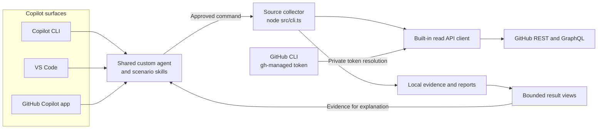

# GitHub Admin Agent

An evidence-first reference implementation for GitHub organization administration through **GitHub Copilot CLI, VS Code, and the GitHub Copilot desktop app**. Copilot clarifies the request and explains the findings; a shared, deterministic collector validates source data, performs exact calculations, and produces traceable local reports.

The implementation provides three read-only scenarios on `github.com`. It does not change repository settings, archive or delete repositories, revoke credentials, or perform enterprise-wide billing. A completed run describes collected evidence, not a certification of full organization visibility, policy compliance, or invoice finality.

## Architecture



All three Copilot surfaces use the same collector and authorization path. Synthetic demonstrations use local fixtures instead of GitHub and never retrieve a token. See [architecture and trust boundaries](docs/architecture.md) for component, authentication, and recovery diagrams.

## Quick start

Use a full source checkout outside `node_modules`, with Node `^24.0.0` or `^26.0.0`. The local collector targets Linux and macOS. **GitHub CLI (`gh`) is required for live collection**, but is not required for synthetic demonstrations or saved-result views.

```sh
npm ci
node src/cli.ts scenarios list
node src/cli.ts demo --scenario repository-activity-inventory
node src/cli.ts demo --scenario repository-billing-report
node src/cli.ts demo --scenario repository-settings-audit
```

**`node src/cli.ts` is the supported collector entry point.** Node executes the TypeScript source natively; no compilation, custom loader, or build step is required. Run commands from the checkout root with its dependencies installed. A global npm installation, standalone copied entry point, or checkout beneath `node_modules` is not supported. A [runtime-only installation](docs/getting-started.md#production-only-source-checkout) can omit development dependencies.

## Use your Copilot surface

Open this checkout in your chosen Copilot client and select the **github-admin** custom agent. The shared definition is `.github/agents/github-admin.agent.md`; the three scenario skills are under `.github/skills/`.

| Surface | Starting point |
| --- | --- |
| Copilot CLI | Start `copilot` in the checkout and select `/agent github-admin`. |
| VS Code | Open the checkout, open Copilot Chat, and select `github-admin` in the agent picker for a local session. |
| GitHub Copilot desktop app | Open the project in a local session and select `github-admin` in the agent picker or with `/agent`. |

For example: **"Run a synthetic repository-billing-report demo. Preserve exact decimal amounts, keep currencies separate, and explain unattributed usage."** Keep normal command approvals enabled. The [getting-started guide](docs/getting-started.md) covers discovery, client prerequisites, and local execution; [example prompts](examples/prompts.md) cover common requests. Shared files provide an integration path; actual discovery, routing, and approval behavior must be assessed separately for each client.

## Supported scenarios

| Scenario | Outcome | Important boundary |
| --- | --- | --- |
| `repository-activity-inventory` | Active, inactive under a named policy, or unknown for observed repositories. | Push-only by default; no billing access required. Missing evidence is not inactivity. |
| `repository-billing-report` | Exact repository/product/SKU amounts, attribution buckets, and reconciliation. | Up to six completed UTC months. No invented currency, repository allocation, or invoice-finality claim. |
| `repository-settings-audit` | Compliant, drift, unknown, or not applicable against a versioned settings baseline. | A deterministic comparison, not remediation or a compliance certification. |

`node src/cli.ts scenarios list` is the executable catalog. GitHub Enterprise Server, GHE.com, arbitrary API origins, and cloud-agent execution are outside the declared support boundary.

## Authentication and live use

Install [GitHub CLI](https://cli.github.com/) in the same environment that runs the collector. Copy the synthetic configuration and policy examples as described in [getting started](docs/getting-started.md), then request an authorization plan for the intended scenario:

```sh
node src/cli.ts auth-plan repository-activity-inventory --org example-org
```

This command produces non-secret, scenario-specific guidance. The operator uses `gh auth login` or `gh auth refresh` deliberately; collection never changes accounts or expands scopes automatically. For live runs, the collector privately obtains the token supplied by `gh` and passes it to the built-in API client. Do not print or copy the token into chat, configuration, receipts, or command arguments. Copilot sign-in is separate from GitHub API authorization.

**Live use requires `--live --profile operator-assisted-local` and an explicit credential class.** The default `restricted-reader` profile blocks live collection because effective no-write grants cannot be independently established. Standard `gh` OAuth scopes can permit writes even though this collector only performs reviewed reads. Billing has additional account-role and endpoint-specific credential requirements; successful `gh` login alone is not sufficient.

See [authentication and authorization](docs/authentication.md) for scope setup, `gh` token precedence, and migration from the former `GITHUB_ADMIN_TOKEN` configuration.

## Reliability and results

The built-in REST/GraphQL client provides bounded retries, request deadlines, shared concurrency limits, rate-limit-aware waiting, strict response and pagination validation, and durable recovery under cumulative budgets. It retains usable evidence when another read fails; it does not silently manufacture a complete result. [API client reliability](docs/reliability.md) documents the exact defaults, retry conditions, and limitations.

Reports remain local under the ignored `reports/` directory. The CLI returns bounded JSON rather than full evidence files:

```sh
node src/cli.ts result RUN_ID --view rows --repository example-org/api --limit 25
```

Use the actual run ID and continuation cursor returned by the collector. Result views make no GitHub requests. Preserve financial decimal strings exactly, including small fractions and signed adjustments.

## Documentation

| Guide | Purpose |
| --- | --- |
| [Getting started](docs/getting-started.md) | Installation, client setup, configuration, and deliberate live use. |
| [Architecture](docs/architecture.md) | Components, diagrams, data flow, and trust boundaries. |
| [Authentication](docs/authentication.md) | GitHub CLI dependency, credential source, authorization scopes, and migration. |
| [API client reliability](docs/reliability.md) | Budgets, retries, rate limits, pagination, caching, and recovery. |
| [Operations](docs/operations.md) | Execution status, bounded results, sensitive artifacts, and retention. |
| [Support matrix](docs/support-matrix.md) | Exact operations, credential caveats, and supported environments. |
| [Acceptance](docs/acceptance.md) | Per-client host evaluation and opt-in live contract collection. |
| [Validation](docs/validation.md) | Reproducible offline checks and external assurance boundaries. |
| [Authoring scenarios](docs/authoring-scenarios.md) | Extending the static registry and shared contracts. |
| [Troubleshooting](docs/troubleshooting.md) | Actionable failures without credential escalation. |
| [Distribution and licensing](docs/provenance.md) | Source distribution boundaries and dependency notices. |

This is a reference implementation, not a certified production deployment. Live endpoint/credential acceptance and human-reviewed Copilot-host acceptance remain explicit, separate activities. The package remains `private: true` and `UNLICENSED`; review distribution permissions and [third-party notices](docs/third-party-notices.md) before sharing a source checkout.
