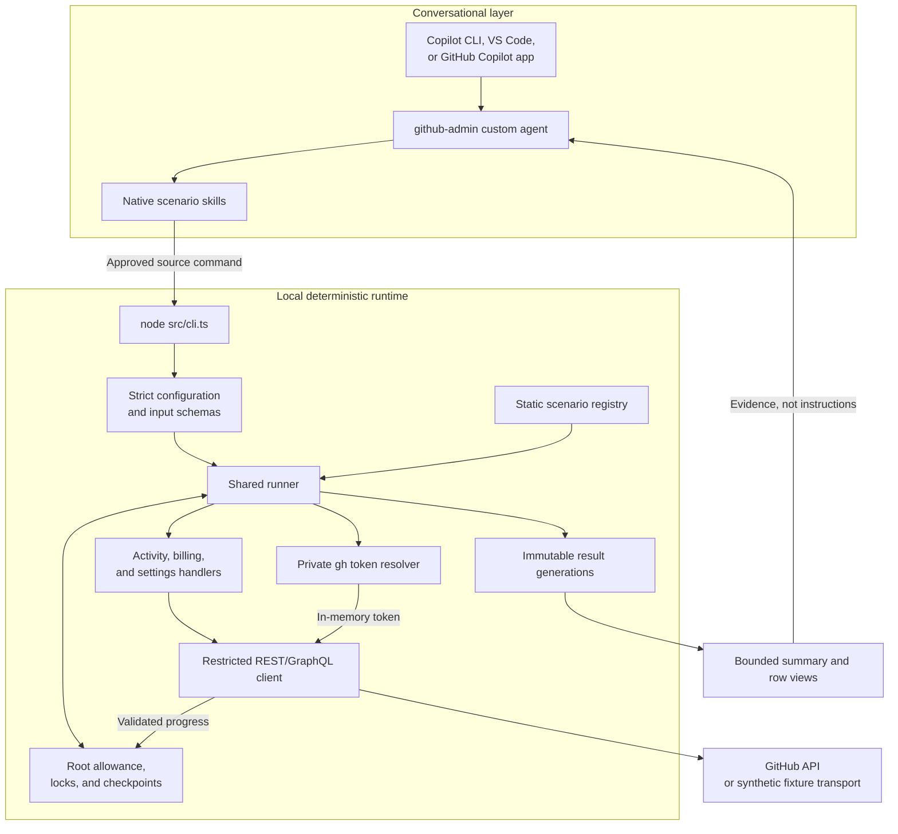
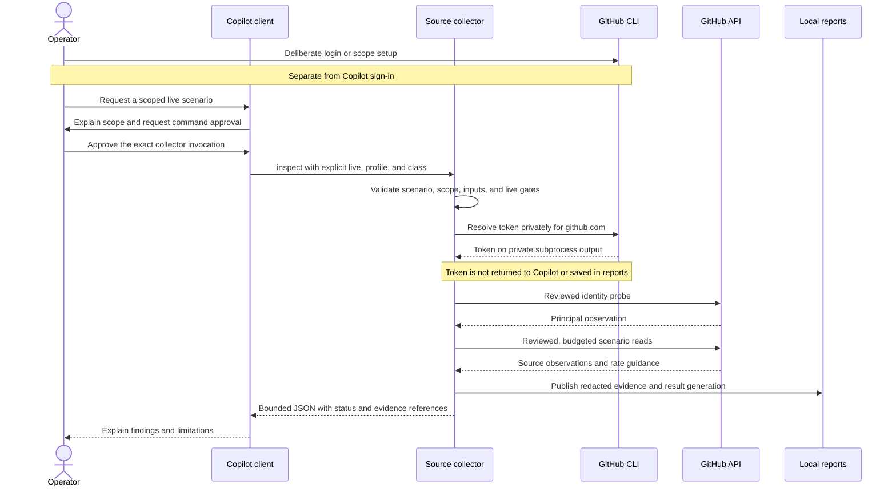
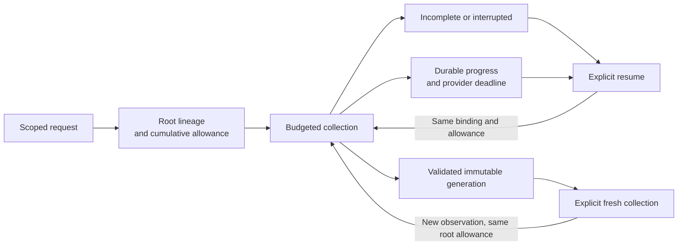

# Architecture and trust boundaries

GitHub Admin Agent separates conversational assistance from deterministic administration. Copilot selects an implemented scenario, resolves scope, requests command approval, and explains results. The local collector owns API requests, validation, classification, exact arithmetic, execution status, and evidence publication. The collector does not invoke a language model.

## Components

| Component | Responsibility | Implementation |
| --- | --- | --- |
| Native adapter | Clarification, scenario routing, normal command approvals, evidence interpretation. | `.github/agents/`, `.github/skills/` |
| Entry point and schemas | Supported command/options, contained local paths, strict configuration and inputs. | `src/cli.ts`, `src/core/config.ts`, `src/core/contracts.ts` |
| Static registry and handlers | Implemented capability manifests and deterministic domain behavior. | `src/scenarios/` |
| Shared runner | Explicit live authorization, principal verification, scenario lifecycle, result validation. | `src/core/runner.ts` |
| GitHub CLI bridge | Non-secret authorization plans and bounded private token resolution for authorized live runs. | `src/core/auth.ts` |
| API client | Reviewed read operations, fixed API origin, safe continuation, bounded requests and responses. | `src/core/client.ts`, `client-operations.ts`, `client-transport.ts` |
| Lineage | Durable attempts, provider deadlines, cumulative allowances, compatible recovery, exclusive locks. | `src/core/lineage.ts`, `storage.ts` |
| Artifact services | Redacted evidence, immutable generations, manifests, exports, bounded views. | `src/core/artifacts.ts`, `result-view.ts` |

There is no required MCP server, hosted service, database server, compilation step, or client-specific reporting engine. Runtime code uses Node's native TypeScript execution from a full source checkout with its locked dependencies installed.

## Authentication and request flow

`gh` supplies the collector's actual token; the built-in client, not `gh api`, performs scenario requests. Token resolution follows `gh`'s configured account and environment precedence. It does not infer token class, organization role, effective grants, or absence of write reach. See [authentication](authentication.md) for setup and credential-specific caveats.

Synthetic demonstrations follow the same runner, handlers, and artifact contracts but use a fixture transport and no token. Saved-result views read local artifacts only. Neither operation is evidence of live authorization.

## Recovery and publication

Resume preserves compatible scope, input, configuration, source identity, principal binding, evidence timestamps, and cumulative allowance. It honors durable provider deadlines and revalidates live identity. Refresh requires an explicit fresh-collection decision and creates linked observations without resetting the root allowance. Recovery is not a way to change organization, token class, policy, or billing period.

Publication stages files, validates their consistency, and publishes a generation through a managed pointer. A later failure does not overwrite an earlier good generation. Manifests and hashes detect local inconsistencies; they do not prove authenticity, complete GitHub visibility, billing finality, or tamper resistance against an operator who controls the filesystem.

## Trust boundaries

| Boundary | Guarantee | Limitation |
| --- | --- | --- |
| Conversation to collector | Shared instructions route to implemented scenarios and require normal approvals. | Instructions and tool aliases are not a security sandbox. Arbitrary shell access remains powerful. |
| Collector to GitHub | Only declared, reviewed semantic reads to `https://api.github.com`; fixed GraphQL queries contain no mutations. | The `gh` token can have broader permissions than the collector uses. |
| Source response to result | Strict containers, exact financial values, explicit missing evidence, validated pagination, retained provenance. | Access-limited or retained provider history cannot prove organization-wide or historical completeness. |
| Result to model | Bounded summaries and pages with exact numeric strings and evidence references. | Reports can contain sensitive organization data; model disclosure still needs operator approval. |
| Local state to recovery | Managed roots, locks, immutable generations, sealed state, source/configuration binding. | Local files are not an independently trusted authorization authority. |

Use credential-isolated, operator-managed collection if the deployment requires a stronger boundary than an agent with local execution tools. Keep live reports and private configuration out of source distributions. [Operations](operations.md), [reliability](reliability.md), and the [support matrix](support-matrix.md) describe the operational limits.
