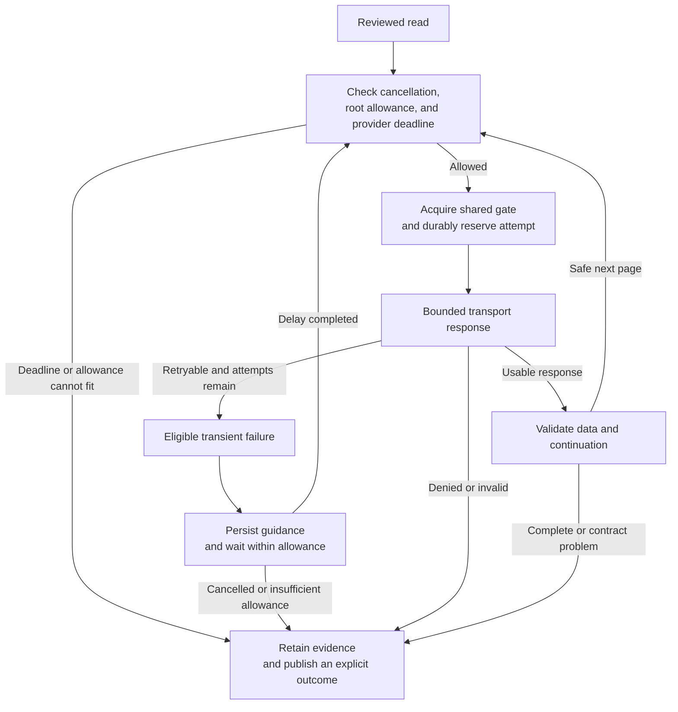

# Built-in API client reliability

The collector uses its own bounded REST/GraphQL read client. GitHub CLI supplies authentication; it does not replace the client's transport, pagination, validation, budgeting, or recovery logic. These controls reduce specific failure modes, but do not constitute an availability SLA, production-scale performance result, or guarantee of complete provider data.

## Defaults and resource limits

| Control | Default | Behavior |
| --- | --- | --- |
| Cumulative API attempts | 1,000 | Every page and retry reserves durable allowance before transport. |
| Cumulative elapsed allowance | 900,000 ms (15 minutes) | Active execution and waiting are bounded across a root lineage. |
| Request timeout | 30,000 ms | Each request is limited by the smaller of this timeout and remaining elapsed allowance. |
| Attempts per page/request | 3 total | The initial attempt plus at most two eligible retries; all consume the cumulative allowance. |
| Concurrent reads | 2 | Clients sharing a budget also share its concurrency gate. |
| Response body | 8 MiB | Both declared content length and streamed bytes are checked; malformed UTF-8 is rejected. |
| Model-facing JSON | 64 KiB of UTF-8 | Summary/row views are bounded independently of full locally retained evidence. |

CLI output normally uses readable four-space indentation. If that representation would exceed the byte limit, the same JSON values are emitted without indentation; the final serialized bytes are still checked against the cap. Consumers should parse JSON rather than rely on whitespace.

Initial limits are validated configuration under `budgets`. A new inspect request can override cumulative attempts with `--max-requests` and elapsed allowance with `--max-elapsed-ms`. Recovery can add allowance only through explicit increment options and a recorded `--allowance-reason`; it cannot silently reset counters.

Authentication is a separate preflight before run creation, not an API request counted in this table. Private `gh` token resolution is limited to 10,000 ms, reduced when configured `maxElapsedMs` is lower, and 16,384 combined stdout/stderr bytes. Timeout, cancellation, or excess output terminates the process and closes capture streams; raw output is never a diagnostic. Operator cancellation returns exit `130`. See [authentication](authentication.md) for credential-source and setup details.

Elapsed usage is attached wall time, not the sum of concurrent request durations. Queue waits, provider waits, and retry delays remain within the elapsed allowance. Cancellation while queued prevents another transport invocation. The client stops waiting for a hanging transport even if an injected transport does not cooperate with abort; it cannot terminate arbitrary work inside that transport.

## Retry policy

| Outcome | Automatic retry within the existing allowance? |
| --- | --- |
| Request timeout, including a modeled `TimeoutError` | Yes, up to the per-request attempt limit. |
| HTTP 5xx or 429 | Yes, with applicable provider guidance. |
| HTTP 403 with rate-limit evidence | Yes; distinguished from an ordinary forbidden response. |
| Successful GraphQL response containing only modeled rate-limit errors and no usable requested nodes | Yes, with GraphQL reset guidance. |
| HTTP 401, ordinary HTTP 403, HTTP 422, or redirect | No. Correct the reported authorization or contract problem explicitly. |
| Ordinary network/transport exception | No immediate automatic retry. Retained progress and diagnostics allow deliberate recovery. |
| Invalid JSON, duplicate keys, unexpected content type/container, invalid UTF-8, or oversized response | No. Invalid source data does not become successful evidence. |

Without provider timing guidance, eligible retries use exponential delays starting at 1 second, doubling per retry, and capped at 30 seconds. With the default three attempts, the delays are 1 and 2 seconds. The backoff is deterministic and has no jitter.

The client does not rotate credentials, switch accounts, expand authorization scopes, fall back to another API origin, or replace a failed live response with fixture data. A diagnostic marked recoverable is not a claim that the current call was retried or that recovery is certain.

## Rate-limit-aware waiting

The client recognizes `Retry-After` seconds or HTTP dates, REST rate-limit remaining/reset headers, and modeled GraphQL rate-limit errors. REST reset timestamps are epoch seconds; GraphQL `rateLimit.resetAt` is an ISO DateTime. Applicable deadlines are combined conservatively rather than choosing an earlier value. When rate limiting is established without a usable deadline, the client uses a 60-second wait.

Provider deadlines are persisted before a retry or the next queued read. A successful response that exhausts the reported rate allowance can retain its valid evidence while delaying the next request. GraphQL errors alongside valid nodes preserve those positive observations and make unresolved work explicit.

If a provider wait cannot fit within the remaining time or request allowance, the client records a durable not-before deadline and returns waiting work instead of sleeping indefinitely. Resume cannot issue the affected reads early or shorten the recorded deadline. Required waiting-only work can produce a `deferred` run; a mixture of waiting and failures can instead produce `partial` or `failed`.

## Response and pagination validation

Outgoing requests are constructed from a reviewed operation allowlist and the scenario's declared capabilities. The host is fixed to `github.com` and the API origin to `https://api.github.com`, with REST version `2026-03-10`. Scope and operation arguments are validated before transport. GraphQL POST requests contain only the fixed read queries; arbitrary queries and mutations are not accepted.

REST pagination accepts only scope-preserving links: the same API origin, resource path, and required query values, with valid sequential page numbers and no credentials, fragments, duplicate parameters, or unexpected query keys. Malformed, repeated, escaping, or inconsistent continuations remain explicit problems. A declared item count without enough observed items and a usable continuation is not treated as complete.

GraphQL pagination validates the connection, node identifiers/timestamps, requested rate fields, `hasNextPage`, and bounded cursors, including HTTP 200 responses with field errors. Repeated cursors and incomplete page information stop completeness claims. Empty pages do not terminate a connection that declares a valid next cursor.

The organization billing-detail contract does not model pagination. Unexpected continuation indicators preserve any valid observed partition as incomplete; the client does not follow unreviewed links or substitute a billing-summary endpoint.

JSON parsing rejects ambiguous duplicate keys and invalid data shapes. Billing numeric lexemes are preserved as decimal strings for exact arithmetic; missing currency remains unspecified rather than defaulting to dollars. Domain schemas additionally validate settings, temporal evidence, billing partitions, and reconciliation. Transport success alone is not domain success.

## Caching, checkpoints, and recovery

Completed non-identity collections with valid evidence and no problems can be reused without reissuing reads. Identical concurrent cacheable reads within one client share an in-flight operation. Evidence identifiers and original observation times survive reuse; reuse does not create a fresh observation.

Identity probes are never served from that cache. Live recovery revalidates the principal against the stored binding. Incomplete collections are retried from their reviewed source rather than appended to old partial amounts. The runner also invalidates reusable transport evidence when required domain work remains unresolved.

Validated progress, request reservations, and deadlines are checkpointed durably. Reservation or checkpoint failures produce explicit diagnostics and prevent success-shaped completion. Root locks and expected checkpoint sequences reject stale or concurrent recovery. A changed source identity, configuration, scope, input, or incompatible principal requires a separate authorized request, not an edited checkpoint.

Results publish as immutable generations. Failure receipts preserve an earlier good current generation; neither a disk error nor a failed collection authorizes overwriting prior evidence. See [operations](operations.md#budgets-and-recovery) for exact resume and refresh commands.

## Diagnostics and assurance limits

Diagnostics distinguish access denial, invalid source contracts, transport unavailability, exhausted allowance, provider waits, cancellation, and unsupported continuation. They include reviewed operation/target context, applicable HTTP status, a validated provider request ID when supplied, remediation, and evidence references. Tokens, authorization headers, and raw error bodies are not reported as model-facing diagnostics.

Execution status is separate from assurance: a completed run can still have unverified population and unknown billing finality. The client does not certify credential grants, establish a shell sandbox, recover unavailable provider history, or attest authenticity of operator-controlled local artifacts. There is no adaptive concurrency tuning, distributed coordination, circuit breaker, automatic token renewal, background resume service, or automatic report purge.

## Implementation and regression coverage

The request engine is `src/core/client.ts`, reviewed request/response adapters are in `src/core/client-operations.ts`, and the bounded fetch transport is `src/core/client-transport.ts`. Durable budget/recovery behavior is implemented in `src/core/lineage.ts`; result publication and views are in `src/core/artifacts.ts` and `src/core/result-view.ts`.

`tests/core/client.test.ts` covers pagination, errors on HTTP 200, exact billing lexemes, retries, provider deadlines, concurrency, cache reuse, cancellation, byte limits, and redaction. `tests/core/lineage.test.ts`, `tests/core/runner.test.ts`, and `tests/core/artifacts.test.ts` cover durable reservations, binding/identity recovery, unresolved domain evidence, and publication failure boundaries. These are offline regression checks, not live endpoint or performance certification.
